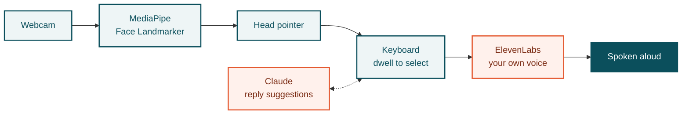

<p align="center">
  
</p>

# VisualEyes

> **Speak with your head and stay part of the conversation.**

**Hack the Change 2026** · Team ShayP (**P76W26**)

VisualEyes is a webcam-only, conversation-first communicator for people who can't speak or use their hands, such as people living with ALS, cerebral palsy or locked-in syndrome. It runs on any laptop with a webcam. The user looks at a suggested reply, and VisualEyes speaks it aloud. Typing is the mechanism. The conversation is the product.

## The problem

Dedicated eye-tracking communication devices cost thousands of dollars and still make people type one letter at a time. A conversation at that speed loses its jokes, its timing and its warmth. People drift away from friends and family, and isolation is itself a health risk.

## What VisualEyes does

- **Webcam-only gaze control.** MediaPipe face and iris landmarks, with a 9-point calibration. Gaze tracking runs on-device, so no video leaves the laptop.
- **Built for imperfect tracking.** Large targets, dwell selection (~700 ms) and a prediction-first layout, so a few degrees of error doesn't break the experience.
- **Conversation-first suggestions.** Claude proposes replies based on who the user is talking to and the topic, so most messages take one selection.
- **Learns your voice.** Your own phrases, jokes and the names of the people you love get surfaced first over time.
- **Hears the other side.** The partner's speech is transcribed live so the user can follow the conversation. Replies are spoken aloud with text-to-speech.
- **Local support.** Keenable surfaces real accessible activities and ALS support groups in Calgary.

## Measured results

Measured on **8 Nov 2026** with the pointer tracker. Two testers (able-bodied, no glasses), normal indoor lighting, a Windows laptop with a 14-inch screen at 1680×1050 and its built-in webcam, in Chrome. Dwell was the default 1.5 s. Raw data was replayed with `npm run replay`; the output is in [VisualEyes/docs/replay-results-2026-11-08.json](VisualEyes/docs/replay-results-2026-11-08.json).

| Metric | Result |
|---|---|
| Target test, 6-button home screen: correct selections (pointer visible, 6 trials per person) | **100%** (2 of 2 testers, 0 wrong, 0 timed out) |
| Target test, 4×4 keyboard including all four corners (8 trials per person) | **100%** (2 of 2 testers) |
| Median time to select a button in the target test | **2.3 to 2.9 s** at a 1.5 s dwell |
| Open-loop hit rate on held-out check dots, 6-button layout (no pointer shown, 7 calibrations) | **62%** of frames on target (16-key grid: 36%) |
| Open-loop pointing error after calibration (estimated, 7 calibrations) | **2.9°** mean |
| Messages per minute, suggestions vs. letter-by-letter | not measured yet |

The target test is what using the app feels like: the user sees the pointer and steers it onto each highlighted button until the dwell selects it. The open-loop numbers measure blind aiming at a dot with no pointer, so they are the floor, not the experience. Every number above is from able-bodied testers.

## How it works



Teal runs on the laptop, so video never leaves it. Orange is a cloud service that only receives text.

| Layer | Tech |
|---|---|
| Gaze tracking | MediaPipe Face Landmarker, iris landmarks, One Euro smoothing |
| Frontend | [React / Vite] |
| Suggestions | Claude API |
| Speech | Web Speech API (partner transcription), browser TTS |
| Backend | [AWS / Supabase] |
| Automation | n8n |
| Local resources | Keenable |

## Getting started

```bash
git clone [repo-url]
cd gazetype
cp .env.example .env     # add your API keys
npm install
npm run dev
```

Open the app in Chrome, allow webcam access, and complete the 9-point calibration. Sit about 50–70 cm from the screen in even lighting for the best results.

**Fallbacks:** if gaze tracking is unreliable in your lighting, switch to pointer mode or the keyboard mode in settings. The conversation engine works the same way in both.

## Privacy and safety

- Video is processed in the browser and never uploaded.
- Only the text of selected messages and the user's learned phrases are stored.
- VisualEyes is a communication aid, not a medical device.

## Roadmap

- Swipe-style dwell-free gaze typing
- Multi-language support
- Caregiver mode and emergency phrases
- Validation with ALS clinicians and users

## Team

Team **P76W26** at **Hack the Change 2026**.

| Name | GitHub |
|---|---|
| Aaryan Dhand | [@Dhandu7](https://github.com/Dhandu7) |
| Adeeb Hossain | [@AdeebHossain](https://github.com/AdeebHossain) |
| Chetan Tyagi | [@chetanty](https://github.com/chetanty) |
| Derek Atabayev | [@derekatab](https://github.com/derekatab) |
| Rajvir | [@Rajvir3104](https://github.com/Rajvir3104) |

Built at Hack the Change 2026, November 2026.

## License

[MIT]
