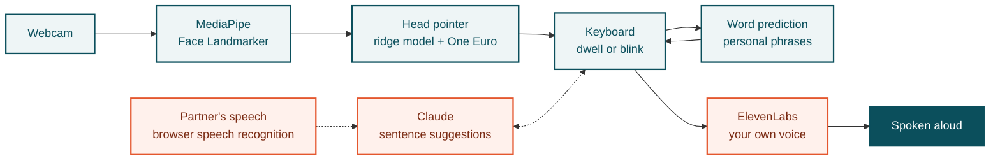

<p align="center">
  
</p>

# VisualEyes

> **Speak with your head and stay part of the conversation.**

**Hack the Change 2026** · Team ShayP (**P76W26**)

VisualEyes lets people who can't speak or use their hands, such as people living with ALS, cerebral palsy or locked-in syndrome, hold a conversation using only a laptop webcam. A small head movement steers a pointer, a short dwell selects, and VisualEyes speaks the message aloud, in the user's own voice if they set one up. There is no special hardware, and video never leaves the laptop.

## The problem

Dedicated eye-tracking communication devices cost thousands of dollars and still make people type one letter at a time. A conversation at that speed loses its jokes, its timing and its warmth. People drift away from friends and family, and isolation is itself a health risk.

## What VisualEyes does

- **Head pointer from any webcam.** MediaPipe Face Landmarker tracks the face on-device at about 30 fps. A 20-dot calibration (about 55 s) fits a ridge-regression model from head yaw and pitch to the screen, then a One Euro filter keeps the pointer steady.
- **Built for imperfect tracking.** The app opens on 6 large ready-to-speak phrases. Selection is by dwell (1.5 s by default) or a deliberate blink, and targets snap and hold so small wobbles don't cause wrong picks.
- **Prediction-first typing.** A 4×4 keyboard of letter groups with word completion, next-word prediction and a personal phrase store that learns every sentence the user speaks. Abbreviation expansion turns one key per word into a full sentence.
- **AI reply suggestions.** Claude suggests whole sentences that match the user's profile and writing style. Only text is sent, never video.
- **Hears the other side.** With "Listen to the other person" on, the partner's speech is transcribed in the browser and Claude offers replies on the home screen, so answering takes one selection. What was heard shows on screen, the microphone is muted while the app speaks, and no audio is stored.
- **Your own voice.** "My voice" clones the user's voice from their recordings with ElevenLabs. Without it, the browser's system voice speaks.
- **Profiles and sign-in.** Each user has their own words, phrases and calibration. Caregivers can add names of people, an about note and writing samples. Auth0 sign-in syncs settings and profile between devices.
- **Works over any app.** An Electron overlay opens with a global shortcut (`Ctrl+Shift+G` / `⌘⇧G`), an offline voice command ("gaze type") or by aiming at the top-right corner, then pastes the sentence into the app you were using.
- **Measured, not guessed.** Sessions can be recorded and replayed offline to compare tracking changes, and a built-in benchmark reports words per minute, selections per character and errors.

## Measured results

Measured on **8 Nov 2026** with the pointer tracker. Two testers (able-bodied, no glasses), normal indoor lighting, a Windows laptop with a 14-inch screen at 1680×1050 and its built-in webcam, in Chrome. Dwell was the default 1.5 s. Raw data was replayed with `npm run replay`; the output is in [VisualEyes/docs/replay-results-2026-11-08.json](VisualEyes/docs/replay-results-2026-11-08.json).

| Metric | Result |
|---|---|
| Target test, 6-button home screen: correct selections (pointer visible, 6 trials per person) | **100%** (2 of 2 testers, 0 wrong, 0 timed out) |
| Target test, 4×4 keyboard including all four corners (8 trials per person) | **100%** (2 of 2 testers) |
| Median time to select a button in the target test | **2.3 to 2.9 s** at a 1.5 s dwell |
| Open-loop hit rate on held-out check dots, 6-button layout (no pointer shown, 7 calibrations) | **62%** of frames on target (16-key grid: 36%) |
| Open-loop pointing error after calibration (estimated, 7 calibrations) | **2.9°** mean |
| Messages per minute, suggestions vs. letter-by-letter | not measured yet |

The target test is what using the app feels like: the user sees the pointer and steers it onto each highlighted button until the dwell selects it. The open-loop numbers measure blind aiming at a dot with no pointer, so they are the floor, not the experience. Every number above is from able-bodied testers.

## How it works



Teal runs on the laptop, so video never leaves it. Orange is a cloud service that only receives text, except the optional partner listening, where Chrome's speech recognition sends the microphone audio to Google to be transcribed. If ElevenLabs isn't set up, the system voice speaks instead.

## Built with

| Area | Technology |
|---|---|
| Languages | TypeScript, Python, HTML, CSS |
| Front end | Vite, plain TypeScript (no UI framework) |
| Desktop overlay | Electron |
| Face tracking | MediaPipe Tasks Vision (Face Landmarker), running in the browser |
| Pointer model | Ridge regression and One Euro filter, written from scratch |
| Offline voice commands | Vosk (browser WebAssembly build) |
| Partner listening | Web Speech API (browser speech recognition) |
| AI suggestions | Claude API (Anthropic SDK) through a small Node.js proxy |
| Voice cloning and speech | ElevenLabs API, with the browser's speech synthesis as fallback |
| Voice and account service | Python, FastAPI, boto3 |
| Sign-in | Auth0 |
| Database | Amazon DynamoDB |
| Cloud | AWS EC2 (hosting), AWS Secrets Manager (API keys) |
| CI/CD | GitHub Actions (deploys to EC2 on every merge to `main`) |
| Testing | Vitest, pytest |

## Getting started

```bash
git clone https://github.com/Dhandu7/HTC2026.git
cd HTC2026/VisualEyes
npm install
npm run setup          # downloads the face model so it works offline
npm run dev            # http://localhost:5173
```

Open it in Chrome, follow the setup screens, allow the camera and point your head at each calibration dot as it appears. Sit about 50 to 70 cm from the screen in even lighting.

Optional extras:

```bash
cp .env.example .env   # add ANTHROPIC_API_KEY and/or ELEVENLABS_API_KEY
npm run dev:all        # app + Claude suggestion proxy
npm run dev:voice      # app + Claude proxy + own-voice service
npm run overlay        # Electron overlay
npm test               # unit tests
```

No camera? **Mouse mode** runs the same interface with hover-to-dwell. Developer details, file-by-file notes and the recording workflow are in [VisualEyes/README.md](VisualEyes/README.md).

## Privacy and safety

- Video is processed on the device and never uploaded.
- Learned words, phrases and calibration stay on the device. Only settings and the profile sync when signed in.
- Partner listening is off by default. When on, Chrome's speech recognition sends the microphone audio to Google to be transcribed. VisualEyes stores no audio.
- Claude and ElevenLabs receive text only. Voice recordings go to ElevenLabs only after the user agrees to a consent screen, and the voice can be deleted at any time.
- A slur filter blocks slurs before anything is spoken.
- VisualEyes is a communication aid prototype, not a medical device.

## Roadmap

- Test with people living with ALS and other motor impairments, with their clinicians
- Dwell-free swipe typing
- More languages (English only today)
- Caregiver mode and emergency phrases

## Team

Team **P76W26** at **Hack the Change 2026**.

| Name | GitHub |
|---|---|
| Aaryan Dhand | [@Dhandu7](https://github.com/Dhandu7) |
| Adeeb Hossain | [@AdeebHossain](https://github.com/AdeebHossain) |
| Chetan Tyagi | [@chetanty](https://github.com/chetanty) |
| Derek Atabayev | [@derekatab](https://github.com/derekatab) |
| Rajvir | [@Rajvir3104](https://github.com/Rajvir3104) |

Built at Hack the Change 2026, November 2026.
